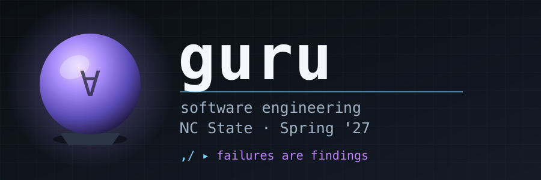

  
  
  
  
  
  
  

# Schedule

CSC 491-014 (9808) / CSC 591-014 (9812) — one class, two numbers.
Tuesdays 4:30–7:15pm, 02211 Textiles Complex.
Jan 12 – Apr 27, 2027 (14 classes).
See [policies](docs/lect/policies.md) for grading.

**Key dates.** First day of classes Jan 11, so our first class is Jan 12.
No class Feb 16 (Wellness Day) or Mar 16 (Spring Break, Mar 15–19).
Last class Apr 27. Reading Day Apr 28. Commencement May 8.
**Last day to appeal grades: Wed May 5.** Grades submitted Fri May 7, 5:00pm.
MLK Day (Jan 18) and New Year's Day fall on a Monday and a Friday, so
this class loses no Tuesday to them.

**Marks.** Quizzes 13, project, mid-term 18, final 36 (final = twice the mid-term). 591 students also write an essay. A bad project or mid-term can be voided onto the final — see [policies](docs/lect/policies.md).

**Exams.** Mid-term: Mar 23, in class. Final: **Thu Apr 29, 3:30–6:00pm**
— the NCSU slot for Tu 4:30 classes. Note it is a Thursday, not our usual
day, and starts an hour before our usual time.

| 📅 Date | 🎓 Lecture | 🛠️ Project  (due start of class) | 📝 Review |
|:-------:|:----------:|:-----------------------------------:|:---------:|
| Jan 12 | intro (1 of 2) |   | |
| Jan 19 | intro (2 of 2) | **P-1:** intro | |
| Jan 26 | stats | **P1:** stats (census ≈ Jan 25–26) | |
| Feb 02 | test generation | **P2:** test case generation via clustering + interpolation | |
| Feb 09 | evaluation | **P3:** check generation works: classifier on real data, 80:20 (or 80% → interpolate → train), then test; stats + eval criteria | |
| 🟩 ${\color{green}\textsf{Feb 16 — Wellness Day, no class}}$ | | | |
| Feb 23 | build | | |
| Mar 02 | build | **P4:** build it: a tune-able system | |
| Mar 09 | scale-up | **P5:** run against data: does it scale? | |
| 🟩 ${\color{green}\textsf{Mar 16 — Spring break, no class}}$ | | | |
| Mar 23 | 🟥 ${\color{#ff9999}\textsf{Mid-term exam}}$ | **P6:** mid-term | |
| Mar 30 | decision support | | |
| Apr 06 | decision support | **P7:** decision support | |
| Apr 13 | surprise | **P8:** run against data: what surprises? | |
| Apr 20 | redesign | | |
| Apr 27 | redesign (last class) | **P9:** redesign: how to run it better | |
| 🟥 ${\color{#ff9999}\textsf{Thu Apr 29, 3:30–6:00pm (final exam slot)}}$ | | **P10:** run again: a better system (final deliverable) | |
| May 05 — last day to appeal grades | | | |
| May 07 — grades submitted, 5:00pm | | | |

