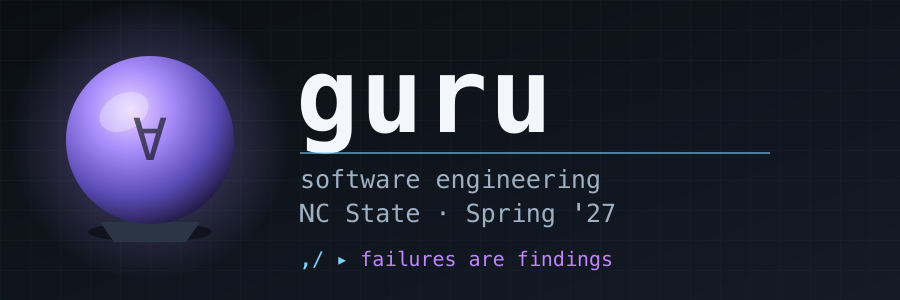

  
  
  
  
  
  
  

# Course Policies

| About | Notes |
|------:|-----|
|What   | guru: software engineering for AI-assisted development |
|Term   | 2027 Spring Term |
|Subject / Catalog Nbr / Section | CSC 491, Section 014 (9808) — undergraduate   CSC 591, Section 014 (9812) — graduate |
|When   | Tu 4:30PM - 7:15PM, Jan 11 – Apr 27, 2027 |
|Where  | 02211 Textiles Complex |
|Who    | Lecturer: [Prof Tim Menzies](http://timm.fyi), <timm@ieee.org> |
|Office hours | By appointment |
|Course website | [https://github.com/txt/guru27s](https://github.com/txt/guru27s) |
|Credit hours | 3 |
|Textbook | None |
|Auditing | Not permitted |

The two section numbers are one class, meeting together. The only
difference is the essay, which 591 students write and 491 students do not.

## Course Description

Code generation is now cheap and checking it is not. This course is about
the half of software engineering that did not get cheaper: deciding what a
system should do, and knowing whether it does it.

Students build one system across the semester and keep measuring it:
generate test cases, check that the generation works, build something
tunable, run it at scale, add decision support, then redesign it. Each
stage reports what broke. Honest failed results score marks; hidden
failures cost more than honest low ones.

The schedule of activities on the course README is subject to change,
with appropriate notification to students.

## Student Learning Outcomes

Upon completion of this course, students will be able to:

1. Design, implement and evaluate a working software system, tune it, and
   run it against real data at scale.
2. Analyze a problem to the point of a checkable claim — metric,
   threshold, baseline — and build a runnable instrument that tests it.
3. Generate test inputs automatically, and judge the result when no
   expected output exists.
4. Make informed judgments about AI assistants on real engineering tasks:
   direct them, verify their output against evidence, and document their
   errors.
5. Communicate negative and surprising results honestly and precisely.
6. (591 only) Survey and critique current SE methods against the research
   literature, in writing, to publication standard.

### Mapping to NC State CSC Student Outcomes

These course outcomes support the departmental
[Student Outcomes](https://csc.ncsu.edu/academics/objectives-and-outcomes/)
(SO1–SO6) as follows.

| CSC Student Outcome | Course outcomes | Assessed by |
|---|---|---|
| SO1 Analyze a complex computing problem and apply principles of computing | 2, 3 | Project, mid-term, final |
| SO2 Design, implement and evaluate a computing-based solution | 1, 2 | Project |
| SO3 Communicate effectively in a variety of professional contexts | 5, 6 | Project reports, 591 essay |
| SO4 Recognize professional responsibilities and make informed judgments | 4, 5 | Project, AI-use disclosure |
| SO5 Function effectively as a member or leader of a team | — | Not assessed in this course |
| SO6 Apply computer science theory and software development fundamentals | 1, 3 | Project, quizzes, exams |

SO5 is deliberately left unassessed: the graded work here is individual,
and an outcome is only claimed when a graded deliverable actually
measures it.

## Student Performance Assessment

Graded on in-class quizzes, a project, a mid-term and a final exam.
591 students also write an essay. The final exam is worth exactly twice
the mid-term. Exam dates and all due dates: see the schedule on the course
[README](https://github.com/txt/guru27s/blob/main/README.md).

**CSC 491 (undergraduate) — total 100 marks:**

| Marks | Component |
|------:|-----------|
| 13 | In-class quizzes: 1 mark each, one per class, no quiz on mid-term night |
| 33 | Project (P1–P10), graded across the semester |
| 18 | Mid-term exam |
| 36 | Final exam |

**CSC 591 (graduate) — total 100 marks:**

| Marks | Component |
|------:|-----------|
| 13 | In-class quizzes: 1 mark each, one per class, no quiz on mid-term night |
| 21 | Project (P1–P10), graded across the semester |
| 12 | Essay (see below) |
| 18 | Mid-term exam |
| 36 | Final exam |

### Essay (591 students only)

One essay per person — not per team. Topic: specific software engineering
methods and practices in the age of LLMs. Name the methods, say what
changed and what did not, and argue it from the literature rather than
from opinion.

- Eight pages maximum, **including** references.
- ACM journal format: `\documentclass[acmsmall]{acmart}`. PDF to Moodle.
- References are extensive and load-bearing. A claim about what LLMs
  changed needs a citation or a measurement, not an assertion.
- The marks are for the argument and its evidence, not for length.

### Voiding a component to bet on the final

If the project or the mid-term went badly, you may transfer those marks
onto the final exam instead of repeating the work.

**How it works.** You declare, in writing, that your project mark and/or
your mid-term mark is void. A voided component is then worth 0 marks to
you, and its marks are added to the value of the final exam. The course
still totals 100.

For a 491 student, whose final is normally worth 36:

| You void | Final exam becomes worth | Everything else |
|----------|-------------------------:|-----------------|
| nothing | 36 | quizzes 13, project 33, mid-term 18 |
| the mid-term | 54 | quizzes 13, project 33, mid-term 0 |
| the project | 69 | quizzes 13, project 0, mid-term 18 |
| both | 87 | quizzes 13, project 0, mid-term 0 |

591 students work the same way, using their own numbers from the table
above: a voided project moves 21 marks onto the final, a voided mid-term
moves 18.

**Rules.**

- Declare it in writing to <timm@ieee.org> by the last class, Apr 27.
- It is irreversible. Once a component is void, its original mark is gone
  even if the final goes worse than it did.
- Quizzes and the 591 essay cannot be voided.
- This replaces any other make-up work. There is no extra assignment.

**Attendance and participation:** Classes are in person. Quizzes happen in
class and are the attendance mechanism. Absences are handled under NCSU
REG 02.20.03 (Attendance Regulations).

**Late work:** Late submissions lose one mark per day late (weekends count
as one day).

**Grading scale:**

    A+ (97-100),  A (93-96),   A- (90-92)
    B+ (87-89),   B (83-86),   B- (80-82)
    C+ (77-79),   C (73-76),   C- (70-72)
    D+ (67-69),   D (63-66),   D- (60-62)
    F  (below 60)

## Additional Required Cost-Bearing Course Materials

This course engages diverse scholarly perspectives to develop critical
thinking, analysis, and debate; inclusion of a reading does not imply
endorsement.

There is no required textbook and there are no course-related fees.

A laptop computer is required in each lecture. NC State University Libraries
offers Technology Lending, where many devices are available to borrow for a
7-day period, and computer labs are available in various locations around
campus for student use.

## Communication

- For private queries, use <timm@ieee.org>.
- For most queries, use the class chat server. It is each student's
  responsibility to join; all class communication from staff to students
  will be via that server.
- Expect a response within two business days (i.e. not over the weekend).
  Messages sent outside office hours need not be answered until the next
  working day.
- Always include a descriptive, specific but concise subject, your course
  number and section, and adequate context. Use your NC State email account.
- Any temporary change in course modality due to unforeseen circumstances
  will be announced via both Moodle and the class chat server.
- Remember: all your posts here are public. Always be professional and polite.

## Academic Integrity

Students are expected to do their own work on quizzes and exams. For the
project and the essay, use of AI assistants and other tools is permitted
and encouraged, but all submitted work must disclose what tools were used
and how, and students must be able to explain everything they submit.

Students are bound by the Pack Pledge: "I have neither given nor received
unauthorized aid on this test or assignment."

Violations of academic integrity will be handled in accordance with the
Student Discipline Procedures (NCSU REG 11.35.02).

## Accommodations

Reasonable accommodations will be made for students with verifiable
disabilities. To take advantage of available accommodations, students must
register with the NC State University Disability Resource Office. For more
information on NC State's policy on working with students with disabilities,
please see the Academic Accommodations for Students with Disabilities
Regulation (NCSU REG 02.20.01).

## Student Mental Health

As a student, you may experience a range of personal issues that can impede
learning. The Counseling Center at NC State offers confidential mental health
services for full-time NC State students, including same-day emergency
services. A full overview of campus wellness resources can be found on the
[WolfPack Wellness website](https://wellness.ncsu.edu). Please do not hesitate
to get connected early for the support you need to be successful.

## Digital Course Components and Recording

Course materials and student work live in public GitHub repositories and the
class chat server. Students may be required to disclose personally identifiable
information to other students in the course, via digital tools, where relevant
to the course. All students are expected to respect the privacy of each other
by not sharing or using such information outside the scope of the course.

Lectures may be recorded. Unauthorized audio or video recordings and
photographs of class lectures or discussions are prohibited; unauthorized
recording and distribution may violate federal privacy laws (FERPA),
copyright laws, and the university's Code of Student Conduct.

## University Policies

Students are responsible for reviewing the NC State University Policies,
Rules, and Regulations (PRRs), which pertain to their course rights and
responsibilities, including, but not limited to:

- POL 04.25.05 Equal Opportunity and Non-Discrimination Policy Statement
- REG 02.20.01 Academic Accommodations for Students with Disabilities
- POL 11.35.01 Student Conduct
- REG 11.35.05 Code of Student Conduct
- REG 11.35.02 Student Discipline Procedures
- REG 02.20.03 Attendance Regulations
- REG 02.50.03 Grades and Grade Point Average
- REG 02.20.15 Credit-Only Courses
- REG 02.20.04 Audits
- REG 08.00.11 Online Course Material Host Requirements
