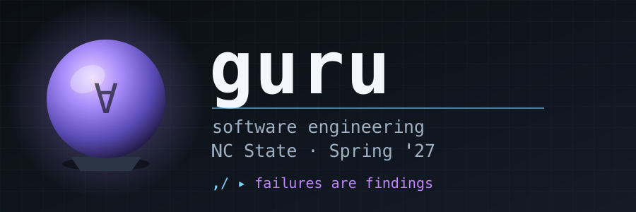

  
  
  
  
  
  
  

# Are you a guru?

A guru is not a senior person. Seniority is time served. A guru is
someone whose judgment you would trust on a problem nobody has solved
before, in a codebase nobody understands, under a deadline.

This page is what that judgment is made of. Eight things. The first
three are about knowing, building and finding out. The last five are
about deciding and living with the result — the half that gets skipped.

## 1. Breadth

Gurus know a large range of fundamentals: design heuristics, several
languages, the core principles of computing, and the common tools and
tricks.

Breadth is not trivia. It is the ability to recognise that the problem
in front of you is an old problem wearing new clothes. You cannot
recognise what you have never seen. One language teaches you one way to
be wrong.

## 2. Build for the people who will pull it apart

Gurus know that other people — and now other programs — will take what
they built, break it into pieces, and use those pieces in ways nobody
intended. So they build for that: documentation, modularity,
configuration, clean seams.

The full treatment is in [tui.md](tui.md). The short version: the unit of
theft is one file. Make each one do one job, run standalone, carry its
own documentation, and depend on nothing exotic. Assume the thief is in a
hurry and will not read your wiki.

## 3. Software engineering is an experiment

Gurus treat design as something you find out about, not something you
decide in advance. Different designs are hypotheses. So they know test
case generation, A/B testing, statistics, and visualization.

**The hinge is the oracle problem.** Generating inputs is easy — inputs
are cheap and a fuzzer writes them for free. Knowing whether the output
is *right* is the hard part, and it does not get easier. Everything in
this course that looks like testing is really about building oracles:
invariants, metamorphic comparisons, models to check against. If you
remember one idea from the semester, remember that generating is cheap
and judging is not.

## 4. Economics: knowing what not to do

This is the sharpest marker of a guru, and the easiest one to miss.

Everything above is about doing work well. None of it tells you which
work to decline. A guru asks: what is the cheapest experiment that could
change my mind? Then runs that one, and not the other nine.

Risk-driven development (Boehm's spiral), value of information, sampling
budgets, early stopping, knowing when more testing has stopped paying.
Without this, section 3 never terminates — there is always another
experiment to run, and a career can disappear into them.

## 5. Trade-offs, not metrics

There is never one number.

Objectives conflict. Faster is bigger, cheaper is worse, more accurate is
slower. So the real job is choosing a point on a frontier and being able
to defend the choice. That is what "requirements" means once you stop
treating it as paperwork.

Gurus distrust any single score, including the ones they invented
themselves. When someone shows you one number, ask what it traded away.

## 6. Reading and deleting beat writing

The scarce skill inverted. Generating code is now nearly free, so writing
it is no longer the bottleneck — and the bottleneck is where the skill
lives.

A guru reads code they did not write, finds the load-bearing five
percent, and deletes more than they add. Code archaeology. Refactoring
toward less. Resisting the strong pull — human and machine alike — to
solve a problem by adding something.

The best patch is usually smaller than the code it replaces.

## 7. Data provenance

Section 3 is only as honest as what goes into it.

Where did this data come from? What was sampled, and what was quietly
excluded? Is there leakage between train and test? How noisy are the
labels? Is the baseline a real baseline or a strawman?

Statistics tells you what the numbers say. Provenance tells you whether
the numbers mean anything. Most "we beat the baseline" results die here,
and they die quietly, long after publication.

## 8. Feedback loops: living with it

The experiment does not end at the demo.

Deploy, observe, roll back. Telemetry. Incidents. The loop in section 3
does not close without the ability to see what the thing does once it is
out of your hands — and production is frequently the cheapest oracle you
will ever get, if you instrument it.

A system you cannot observe is a system you cannot improve. You can only
rewrite it and hope.

## Also worth knowing

Smaller, but they show up constantly:

- **Conway's law, and how decisions actually get made.** Your
  architecture will come to look like your org chart whether you want it
  to or not.
- **Adversarial thinking.** Threat modelling. Red-teaming your own
  output, including an LLM's.
- **The history of silver bullets.** Fourth generation languages, CASE
  tools, UML round-tripping, model-driven architecture. Each promised to
  end programming. Each attacked typing, and typing was never the
  problem. Knowing this record is how you stay calm about the next one —
  see the LLM section of [tui.md](tui.md).

## So: are you a guru?

Not a quiz with marks. A list of questions you should be able to answer
about your own work, and that get harder as you get better.

1. When did you last decide **not** to run an experiment, and why?
2. What does your current project trade away, and who decided that?
3. What is your oracle? How do you know a wrong answer when you see one?
4. Could someone lift one file out of your repo and use it tomorrow?
5. What is the provenance of your data? What is it missing?
6. When your system misbehaves in production, how would you find out?
7. What did you delete this month?
8. Which old idea is your new problem wearing as a disguise?

If most of these are easy, you are reading the wrong page. If most are
uncomfortable, you are in the right class.
