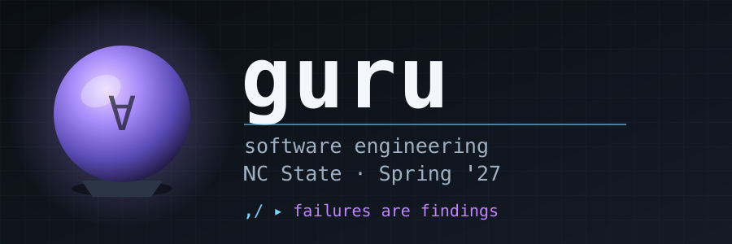

<p align="center">
  <a href="https://github.com/txt/guru27s/blob/main/README.md"></a>
  <a href="https://github.com/txt/guru27s/blob/main/docs/lect/policies.md"></a>
  <a href="#"></a>
  <a href="#"></a>
  <a href="#"></a>
  <a href="#"></a>
  <a href="https://github.com/txt/guru27s/blob/main/LICENSE.md"></a></p>
<p align="center"></p>

# TUIs

Two audiences read what you build: humans,  and other
programs (including AIs) pulling your code apart for the useful bits.
Design for both.

## What is a TUI?

A TUI is a program that draws with characters on a terminal grid, reads
keystrokes, and redraws. No pixels, no toolkit, no window manager. It
runs over `ssh` on a machine you have never seen.

It helps to place it between its neighbours:

| | lifetime | input | output | examples |
|---|---|---|---|---|
| CLI | one shot: start, do, exit | argv, stdin | a stream of text | `ls`, `grep`, `git commit`, `curl` |
| TUI | persists, holds state | keystrokes | a grid of characters, redrawn | `vim`, `htop`, `less`, `tig`, `ncdu`, Claude Code |
| GUI | persists, holds state | mouse and keys | pixels, via a toolkit | VS Code, Chrome, Finder, Figma |

A CLI is a sentence. A TUI is a conversation: it remembers what you did
a moment ago, and what you see next depends on it. That memory is the
whole subject of this page.

Some of these blur. `git` is a CLI, but `git add -p` holds a little
state and reads single keys, which is a TUI trying to get out. VS Code
is a GUI wrapped around a terminal running TUIs.

## Why a TUI, in the age of LLMs?

Be suspicious of the nostalgia argument. "Terminals are cooler" is not a
reason. The reasons that follow are the ones that survive contact with a
sceptic.

Main argument:
an agent can read it and drive it easily. 

A TUI takes keys in and prints text out. Keys and text are the two
things a program finds easiest to send and to read.

So everyone uses it the same way:

| who | sends | reads |
|---|---|---|
| you | `j j d q` on the keyboard | the screen |
| a test | the string `"jjdq"` | the screen, compared to a saved copy |
| an agent | the string `"jjdq"` | the screen, as text it understands |

One way in, one way out, three kinds of user. You build it once.

Now the same picture for a GUI. It prints pixels, and no test or agent
can read pixels. So you build a *second* way in: screenshots,
accessibility hooks, clicking at remembered coordinates. That is two
interfaces to keep working instead of one — and the second breaks every
time somebody moves a button.

The bonuses:

- **A screen is a string, so it diffs.** You can store yesterday's
  screen, compare it to today's, and see exactly what changed. Nobody
  can meaningfully diff a pixel buffer. This single property is what
  makes snapshot testing possible here and painful everywhere else.
- **It runs where the work is.** Over ssh, in a container, in CI, on a
  box with no display and no GPU. Same argument as "works anywhere" in
  [ru_a_guru.md](ru_a_guru.md).
- **Keyboard speed.** When generating a change takes two seconds, a
  mouse round-trip becomes the slowest part of your loop.
- **It is the right size to learn on.** Small enough to build 
  quickly, stateful enough to be genuinely hard, and — unlike a GUI —
  testable end to end.
- **Less to review.** Ask an LLM for a web page and you have to check
  the fonts, the spacing, the colours, what happens on a phone, whether
  the images loaded. Ask it for a TUI and you get characters on a grid.
  Fewer places to be wrong means a faster read. (Generators made *every*
  interface cheap to build, so cheap to build is no reason to pick a
  TUI. Cheap to **check** is.)

## Two challenges

Everything hard about a TUI reduces to two questions:

1. **How do you modularize it** — so the useful parts can be pulled out
   and used by other programs?
2. **How do you test it** — when it is bound to a terminal that no test
   harness wants to drive?

These look unrelated. They are the same bug. Both happen when a program
is written as *a thing that talks to a terminal*, instead of *a thing
that computes, which happens to have a terminal attached*. The logic
ends up tangled with the drawing, so it can be neither extracted nor
exercised.

One idea fixes both. Start with testing, because it is the stricter of
the two: pass the testing bar and modularity comes free.

## Challenge 1: make it testable

### What a state machine actually is

The term gets used loosely. Precisely, a state machine is five things:

- **S** — a set of states.
- **I** — a set of inputs.
- **s0** — a start state, an element of S.
- **d** — a transition function, `d : S x I -> S`. Given a state and an
  input, it says which state you end up in.
- **out** — an output function. If output depends only on the state
  (`out : S -> output`) it is a **Moore** machine. If it depends on the
  state *and* the input that caused it (`out : S x I -> output`) it is a
  **Mealy** machine.

For a TUI the mapping is direct:

| machine | TUI |
|---|---|
| S | everything the program remembers: cursor, buffer, mode, selection |
| I | keystrokes, plus resize, timer ticks, data arriving |
| s0 | the screen you get at startup |
| d | `reduce(state, key) -> state` |
| out | `render(state) -> text` |

Note that `render` takes only the state. That makes a TUI a **Moore**
machine, and it is a deliberate choice rather than a discovery — you
could let rendering peek at the last keystroke, and you must not,
because the moment it does, a screen is no longer reproducible from a
state and snapshot testing dies.

This framing is a design stance, not a fact about TUIs. Plenty of
working ones are nothing of the sort: ncurses code that draws
immediately and keeps no model at all, or an engine like vim's that is
modal without being a pure reducer. The claim is narrower and arguable —
this is the framing that makes a TUI *testable*. If you reject it,
reject the rest of the section with it.

One honesty check: a real TUI is not a *finite* state machine. The state
contains text buffers, so S is astronomically large. What you actually
have is an **extended** state machine: a small finite control (the mode
you are in) plus data variables. Say "state machine", mean this, and do
not promise anyone you will enumerate the states.

### Why this framing earns its keep

The merits, roughly in order of how much they buy you:

1. **`d` is total.** It is defined for every state and every input. So
   "what happens if they hit `q` in the middle of a search?" is not an
   open question, it is a table entry. Gaps become visible instead of
   becoming bugs.
2. **A session is data.** If inputs are values, a session is a list of
   values. Lists can be saved, replayed, mailed in a bug report,
   generated at random, and shrunk. Nearly every technique later on this
   page is downstream of this one sentence.
3. **`render` is pure, so screens are comparable.** Same state, same
   string, always. That is what makes golden files work.
4. **States are values, so you can compare and hash them.** Which gives
   you record/replay, duplicate detection, and a real coverage measure:
   which `(state, input)` pairs have you actually tried?
5. **You can write a second, simpler machine** that models what the
   program *should* do, and compare the two. An oracle that needs no
   expected output.
6. **Reachability becomes a question you can ask.** Can you always get
   back to a usable screen? Is quit reachable from everywhere? These are
   graph questions once you admit you have a graph.
7. **Time does not appear in the model.** No hidden clock means
   reproducible runs, which means a failing test is a real failure and
   not a flake.
8. **Machines compose.** A widget is a machine with its own S, I, `d`
   and `render`, embedded in a parent. Which is challenge 2, answered
   for free — see below.

And the costs, because the framing is not free:

- State explosion is real. You get a graph you cannot draw.
- Long-running and asynchronous work fits awkwardly; it has to be
  modelled as inputs arriving later, which is correct but fiddly.
- It is more ceremony than a tutorial's `while(1) { getch(); draw(); }`,
  and for a fifty-line script that ceremony does not pay.

### Breaking the terminal binding

Terminal binding is why most TUIs go untested. Break it like this:

- **Three pure pieces:** `key -> reduce(state, key) -> state`, then
  `render(state) -> text`. Reducer and renderer are pure and never touch
  a terminal. The terminal driver is twenty lines you never test.
  This is not new: it is The Elm Architecture (Model / Update / View),
  and it is the shape [Bubble Tea](https://github.com/charmbracelet/bubbletea)
  gives every Go TUI — so the framing has an industrial instance, not
  just a theory.
- **Input is data, not typing.** `tui --keys 'jjdq'`, or keys on stdin.
  If a session cannot come from a file, it cannot be tested. This single
  rule buys scripting, tests, fuzzing and bug repro at once.
- **Render to a string.** Golden/snapshot files; the diff is the oracle.
- **Inject every source of nondeterminism:** clock, random seed, cwd,
  environment, terminal size. A hidden `time.now()` is a flaky snapshot.
- **Record and replay.** Log keys plus a per-step state hash. A bug
  report becomes the key log: free repro, and it seeds the fuzzer.
- **Headless exit.** Run the keys, print final state as parseable text,
  let the exit code carry the assertion.

### Input generation

Keys are a small alphabet, so generating strings over it is cheap — and
it finds the sequences humans never type.

- **Random walk first.** Uniform random keys, ten thousand sequences.
  Catches most crashes for about twenty lines of code.
- **Model-based next.** Write the spec state machine (tiny, no
  rendering). Walk both, compare. That is a metamorphic oracle: it needs
  no expected output. This is John Hughes' state-machine QuickCheck:
  give each operation a precondition, a postcondition, an argument
  generator and a state transition, and the tool generates random call
  sequences for you. It has been used on real AUTOSAR CAN and FlexRay
  clusters, so treat it as industrial practice, not an academic toy.
- **Shrink, always.** A 400-key failure is useless; shrink it to five
  keys or do not bother. Delta-debug: drop halves, then singles, keep
  dropping while it still fails. Shrinking failing *sequences* (not just
  single values) is a QuickCheck idea and is what makes random testing
  of state machines usable at all.
- **Mutate real logs.** Your record/replay corpus plus mutation beats
  uniform random — it reaches deep states a random walk never enters.
- **Sweep the hostile dimensions:** sizes 1x1, 80x24, 500x3; wide
  characters, emoji, combining marks; no-color; non-tty stdout; EOF
  mid-session; window resize mid-render.
- **Coverage means (state, key) pairs tried,** not lines executed. Line
  coverage lies about state machines.

### Invariants

Random input has no expected output, so the oracle has to be a property
that holds for every state. This list is the real asset — it is the
specification, and it survives being pulled out of your code.

- `render` never throws, for any reachable state.
- Rendered output fits the declared width and height.
- The cursor is always within bounds.
- `undo(do(s)) == s`.
- `deserialize(serialize(s)) == s`.
- No key sequence produces a blank screen or a dead end: every reachable
  state has a path back out.
- Quit always quits, from any state.

Honest failures here are findings. A reported broken invariant scores;
a hidden one costs more.

## Challenge 2: make it modular

Merit 8 above did most of this work already: a widget is a machine with
its own S, I, `d` and `render`, nested in a parent machine. That is how
Elm and Bubble Tea compose, and it is why a well-built TUI component
lifts out of one program and into another.

The rest is file discipline.

### Worked example: `top` has a way out, `htop` does not

Run `top` and you get a screen. Characters on a grid, redrawn every few
seconds, driven by keys:

```
Processes: 768 total, 2 running, 766 sleeping, 4083 threads            21:49:11
Load Avg: 2.30, 1.65, 1.46  CPU usage: 6.32% user, 10.70% sys, 82.96% idle
SharedLibs: 1068M resident, 215M data, 134M linkedit.
MemRegions: 670649 total, 8538M resident, 349M private, 2517M shared.
PhysMem: 23G used (2763M wired, 5108M compressor), 660M unused.
VM: 358T vsize, 6144M framework vsize, 124878923(0) swapins, 164669009(0) swapou
Networks: packets: 62870380/56G in, 20614352/7846M out.
Disks: 126844305/3238G read, 80530798/3209G written.

PID    COMMAND%CPU TIME     #TH    #WQ  #PORT MEM   PURG  CMPRS PGRP
99791  com.apple.Ap 0.0  00:00.06 21    27    2576K 0B    2256K 99791
99789  Managed Back 0.0  00:00.07 21    46    5072K 0B    4624K 99789
98386  voicebanking 0.0  00:00.15 21    72    6352K 0B    3792K 98386
98385  devicecheckd 0.0  00:00.19 21    65    4864K 0B    3680K 98385
98178  SetStoreUpda 0.0  00:00.04 21    27    2688K 0B    2320K 98178
98171  localspeechr 0.0  00:00.12 21    39    4656K 0B    4224K 98171
```

Now ask the same program for the same information as *data*. `top -l 1`
renders one frame and exits, so a pipeline can read it:

```bash
$ top -l 1 | head -20 | tr -s ' ' | cut -d' ' -f1-10

PID COMMAND %CPU TIME #TH #WQ #PORTS MEM PURG CMPRS
99791 com.apple.AppSto 0.0 00:00.06 2 1 27 2576K 0B 2256K
99789 Managed Backgrou 0.0 00:00.07 2 1 46 5072K 0B
98386 voicebankingd 0.0 00:00.15 2 1 72 6352K 0B 3792K
98385 devicecheckd 0.0 00:00.19 2 1 65 4864K 0B 3680K
```

(`tr -s ' '` squeezes the padding runs; without it, `cut -d' '` counts
every space as a field boundary and asking for fields 1–10 gets you
about three real columns.)

Same program, same numbers, two exits: one for eyes, one for programs.
That is the whole rule — **every function reachable from the interface
must also be reachable without it.**

Now try the same thing with `htop`. There is no `--batch`. The closest
is `htop -n 1`, which exits after one frame but still writes a rendered
screen:

```
^[[?1049h   switch to the alternate screen
^[[1;24r    set the scroll region
^[[2J       clear
^[[32m...   colours, cursor jumps, box-drawing characters
```

3.6KB of escape codes to tell you one thing. To get the numbers out you
must render a screen and scrape it — of your own machine, from a
program that already had the data in a variable.

So `htop`'s process-gathering logic is real, useful, and trapped. You
cannot reuse it, and for the same reason you cannot easily test it. Note
that this is one bug with two faces, exactly as claimed above.

There is a third tier worth seeing. `top`'s text is *aligned for
humans*, so it is scrapeable but fragile — one long process name shifts
the columns. `ps` lets the caller name the fields:

```bash
$ ps -eo pid,pcpu,comm | head -3
  PID  %CPU COMM
    1   0.0 /sbin/launchd
  291   2.1 /opt/homebrew/bin/herdr
```

Three tiers, then: `htop` unreachable, `top` scrapeable, `ps`
structured. Build the third kind.

### The parts of the pipe

Look again at what that one line is made of. Four programs, none of
which knows the other three exist:

```bash
top -l 1  |  head -20  |  tr -s ' '  |  cut -d' ' -f1-10
```

| stage | one job | in | out |
|---|---|---|---|
| `top -l 1` | render one frame of process data, then exit | nothing | text |
| `head -20` | keep the first 20 lines | text | text |
| `tr -s ' '` | squeeze each run of spaces to one space | text | text |
| `cut -d' ' -f1-10` | keep fields 1 to 10 | text | text |

Every stage takes text and emits text. None has a flag that mentions
another. `head` has no idea it is reading process data; `cut` has no
idea a terminal was ever involved.

### Extending by adding a stage, not a feature

Now change the behaviour without touching any program. Want the five
busiest processes? Add two stages:

```bash
$ ps -eo pid,pcpu,comm | sort -k2 -nr | head -4
  968  15.5 .../WindowServer
44211  10.0 /Users/timm/.local/bin/claude
 3418   8.2 /Applications/Ghostty.app/.../ghostty
  617   6.0 /usr/sbin/coreaudiod
```

Want a count of processes per user? Different stages, same parts bin:

```bash
$ ps -eo user | tail -n +2 | sort | uniq -c | sort -nr | head -4
 460 timm
 173 root
  17 _rmd
  13 _accessoryupdater
```

Nobody added a `--sort-by-cpu` flag. Nobody recompiled `ps`. New
behaviour came from new *arrangements* of old parts, and the number of
possible arrangements grows faster than anyone can add options.

This is Doug McIlroy's rule from the 1978 Bell System Technical Journal
foreword to the Unix issue: make each program do one thing well, and
**build afresh rather than complicate old programs by adding new
features**. (The familiar three-line "do one thing / work together /
text streams" version is Peter Salus's 1994 condensation, not the 1978
wording — the idea is McIlroy's, the slogan is Salus's.)

The connection back to this page: a pipe stage and a TUI are the same
shape. Text in, text out, no hidden channel. A program built that way
joins the parts bin. A program that only talks to a terminal does not —
`htop` cannot appear anywhere in the pipelines above, and the only way
to get "htop, but sorted by memory, for one user" is to open its source
and add a feature. That is precisely what McIlroy told you not to do.

### Scavenge layer

The unit of theft is one file. Assume someone lifts a single file out of
your project and runs it elsewhere. Make that work.

- **One file, one job, runs standalone.** No shared mutable globals, no
  initialization order to get right.
- **Doc in-file, machine-greppable.** One convention, two consumers: the
  `## ` line is help text for humans and metadata for `,/help`.
- **Convention over registry.** Discovery by scanning, not by a central
  index that drifts out of date.
- **Plain standard library.** Stolen code must run unchanged. A
  framework dependency makes the file unstealable.
- **Pure core, thin shell.** Logic separate from screen-drawing. The
  logic is the useful bit; keep it liftable.
- **Text in, text out.** Every function reachable from the TUI is also
  reachable non-interactively. No TUI-only path to anything.
- **Line-oriented plain text data,** stable field names. Greppable,
  diffable, pipeable.
- **Names are search keys.** Name things for what someone will grep.
- **Idempotent; print what changed.**
- **Tests beside the code,** runnable alone — a spec that travels with
  the stolen file.
- **Keep each file small enough to read whole.** An AI steals what it
  can read whole, and this one constraint forces most of the rules
  above. "Small" is measured in live variables and branches, not lines
  — see below, because the usual line-count rules do not survive
  contact with the evidence.

### One screen, with docs in the file

Budget the code, not the bytes. One screen means the logic you must hold
in your head at once; documentation does not count against it. That is
not a loophole, because:

- **Docs buy code lines back.** A named invariant at the top of the file
  replaces three defensive `if` statements. A usage example replaces an
  essay on argument parsing. A doc that does not shorten the code is
  decoration — cut it.
- **One block, at the top.** Long documentation goes in the module
  docstring, not sprinkled through the body. The reader scrolls past it
  once, then reads uninterrupted logic. An editor folds it; a program
  strips it with one pattern.
- **Doc lines that execute.** Doctests, and `--keys` examples in the
  usage text, are documentation and test and specification at once.
- **Doc longer than code is a smell with a fix.** It means the prose is
  really a lecture. Move it to `docs/lect/*.md` and leave a one-line
  pointer. The file stays thin and the prose gets room to be good.
- **Two columns.** `pycco` renders comment beside code, so the budget is
  per paragraph of code, not per file.

The real target is that the whole control flow fits in one head.

### What "small" actually means, and what nobody has shown

Be careful here: the famous numbers are weaker than their reputation.

- The one durable industrial rule is the Linux kernel's, and it is
  *relative*: the allowed length of a function shrinks as its complexity
  and indentation depth grow, so a long simple `case` statement is fine
  while a deeply nested function is not. It also caps local variables at
  roughly five to ten. Older versions of that text said "one or two
  screenfuls" of an 80x24 terminal, which is a hardware artifact of 1978
  and not a result about people. Current versions dropped the number.
- The strongest empirical study points the *other* way. Hatton (1997)
  found defect density lowest for components in the low hundreds of
  lines, not the low tens, and explained it by working memory: a
  component that fits the short-term cache uses it efficiently.
  Replications then weakened even that — several found no size to
  fault-density relationship at all, which is what you would expect if
  faults are simply linear in size.
- The memory figure behind all such arguments is about four chunks
  (three to five), not Miller's famous seven, and it is still disputed.
  The unit that matters is the *chunk*, and a chunk of code is not a
  line: a forty-line table initializer is one chunk, while a twelve-line
  nest of conditionals is five.

So count live variables and branches, not lines. That at least has a
mechanism behind it, and it matches the only rule industry actually
follows. Any specific line budget in this course is a house convention
for keeping files stealable — useful, but not a finding. Do not cite it
as one.

## Screen layer

- **Keystroke cost ∝ frequency.** Top ten operations get three keys or
  fewer; the rest can be long. This repo's `,/push` beats `make push`
  for exactly this reason — a directory named `,` makes the prefix two
  keys, and `,/sh` puts `,` on `PATH` so inside that shell it is zero.
- **State visible, not remembered.** Nobody should ask "what mode am I
  in?" If the answer isn't on screen, the screen is wrong.
- **Modeless by default.** If modal, the mode name is always displayed.
- **`?` and `help` always live.** Self-listing beats a hand-maintained
  list: `,/help` scans `,/` for each file's `## ` line, so adding a
  command adds its own help.
- **Degrade.** No color, no unicode, 80x24, non-tty output: still works.
- **Under 100ms, or show progress.** No silent pauses.
- **Reversible by default.** Confirm only what cannot be undone. Offer a
  dry-run flag.
- **Fail loud.** Exact error text, real exit codes.
- **Zero config to start.** Config file optional, never required.

## Checklist

1. Can a session be driven from a file of keys?
2. Does `render` return a string?
3. Is clock/seed/size injected?
4. Is there a model to compare against?
5. Does the fuzzer shrink?
6. Is the invariant list written down, separate from the code?
7. Can one file be lifted out and still run?

## Does this advice survive LLMs?

The fair sarcastic question: surely code generation supersedes all of
this? Brooks' 1986 split sorts it. Generators attack *accidental*
complexity — typing, boilerplate, remembering an API. They barely touch
*essential* complexity — deciding what the thing should do, and knowing
whether it does it. Sort every rule on this page into those two bins and
the answer falls out.

### Superseded

- **Keystroke economy.** `,/push` saves *your* hands. An agent types for
  free and does not care. The most obsolete idea on this page is the one
  it opens with.
- **Discoverability by design.** `,/help` listing itself is for people.
  An agent reads the whole directory anyway.
- **"Hold it in your head."** A model has a context window, not four
  chunks. The cognitive-load argument for small files is about the
  *human* reader, so it weakens when the reader is a machine. Small
  files survive for a different reason: a person still approves the
  diff, and review does not scale.

### Stronger than before

Generating code now costs almost nothing. Checking it costs the same as
it always did. So the bottleneck moved into the half of this page you
would expect to be obsolete.

- **The oracle problem got worse.** An agent writes five hundred lines
  of TUI in ten seconds and you still do not know if it is right.
  Invariants, a fuzzer and a shrinker are the only verification that
  scales with generation speed. Everything else you read by hand, and
  now there is far more to read.
- **The invariant list outranks the code.** Code is becoming
  disposable — regenerate it. The invariant list is what you maintain,
  review and argue about. It was the real asset before; now it is the
  whole game.
- **Input as data went from nice to mandatory.** `--keys 'jjdq'` is how
  an agent drives a TUI. With no key-stream interface, an agent cannot
  test your program at all. Same for headless exit codes and text
  output: that is the agent's entire sensory channel.
- **Record and replay.** An agent cannot watch your screen. The key log
  is the only bug report it can act on.
- **Determinism.** A flaky snapshot burns agent loops forever, because
  the agent cannot tell a flake from a bug and will "fix" both.
- **One file, standard library, greppable.** This part was already
  written for machine readers. Unaffected.

### Unknown

- Every size-and-defects result quoted above was measured on
  human-written code. Whether defect density behaves the same way in
  generated code is an open question — the datasets do not exist yet.
  Treat the earlier section as evidence about human code only.
- "Generation supersedes design" has a long losing record: fourth
  generation languages, CASE tools, UML round-tripping,
  model-driven architecture. Each attacked typing. None attacked
  "is it correct?" or "what should it do?". That record is a prior, not
  a proof — this time could differ, and saying so is not an argument
  that it will.

## Provenance

Separate what is evidence from what is taste — the same rule this course
applies to generated exam questions.

- **Evidence, with caveats:** the size to defect-density literature
  (Hatton 1997 and its contested replications); working-memory capacity
  of about four chunks (Cowan 2001, disputed); the Linux kernel coding
  style as observed industrial practice.
- **Borrowed, with sources:** the reducer/renderer split is The Elm
  Architecture (Czaplicki), reached here via
  [Bubble Tea](https://github.com/charmbracelet/bubbletea), which credits
  it; underneath both sits the plain Mealy machine, where output is a
  function of state and input. Model-based generation and the shrinking
  of failing command sequences are John Hughes' work on QuickCheck —
  see [Software Testing with QuickCheck](https://research.chalmers.se/publication/154999)
  and his [FMCAD 2011 state-machine tutorial](https://www.cs.utexas.edu/~hunt/FMCAD/fmcad11/slides/tutorial-a.pdf).
  The state-machine framing in Challenge 1 is a restatement of those
  ideas, not an original claim. The five-part definition (S, I, s0, d,
  out) and the Moore/Mealy distinction are standard automata theory.
- **Borrowed, with sources (2):** composition over features is Doug
  McIlroy, foreword to the Unix issue of the *Bell System Technical
  Journal*, 1978 — "make each program do one thing well" and "build
  afresh rather than complicate old programs by adding new features".
  The widely quoted three-line summary is
  [Peter Salus, *A Quarter-Century of Unix* (1994)](https://en.wikipedia.org/wiki/Unix_philosophy),
  and is a paraphrase; quote it as Salus, not as 1978.
- **Craft consensus, not measured:** input as data; snapshot and
  golden-file testing; record and replay; injecting the clock and seed.
  Standard practice in property-based testing and terminal-UI tooling,
  and they work, but no study here is being cited for them.
- **House convention:** every specific number on this page, the `,/`
  keystroke argument, and the "unit of theft is one file" framing.
- **Argument, not measurement:** Brooks (1986) on essential versus
  accidental complexity, used above to sort what generators change.
  It is a famous argument that has held up, not an experiment.
- **Open:** whether any of the size-and-defects evidence transfers to
  generated code.

If a claim on this page is going to appear in a quiz, check it first.
